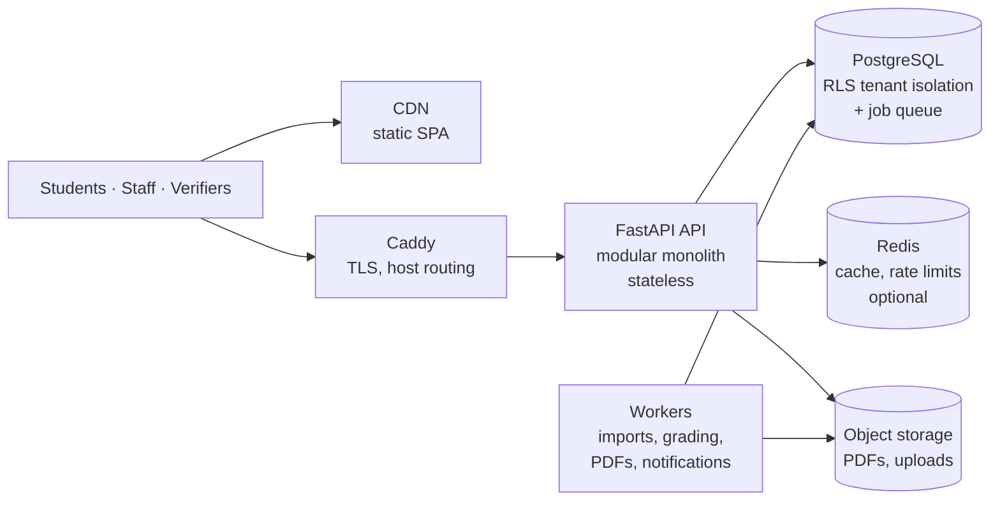

# ScoreCode

**Examination and result infrastructure for educational institutions — a multi-tenant SaaS.**

Institutions import marks, catch errors before students do, publish with one click, and give every student a branded, verifiable marksheet on a portal built to stay up on result day. Every institution (schools, colleges, coaching institutes) is a tenant on one shared platform with strict data isolation. *Thapar Institute of Engineering & Technology is one demo tenant, not the product.*

> **Status: implementation in progress.** Platform kernel, tenancy, identity, entitlements, onboarding, the
> tenant admin app, the platform console, self-serve sign-up, academic structure, the student directory,
> spreadsheet imports (check → fix → commit) and student activation are built and verified in CI. The grading
> engine, exams, marks, results and publication are next. Exact progress: [docs/CHECKLIST.md](docs/CHECKLIST.md).

---

## Start here

| If you want to… | Read |
|---|---|
| Understand the product in 5 minutes | [01 Product definition](docs/01-product-definition.md) |
| See the whole system design | [05 Scalable system design](docs/05-system-design.md) |
| Know what to build next | [CHECKLIST.md](docs/CHECKLIST.md) → [IMPLEMENTATION_PLAN.md](docs/IMPLEMENTATION_PLAN.md) |
| Review the formal SE documents | [SRS](docs/SRS.md) · [SAS (Software Architecture Specification)](docs/SAS.md) · [Diagrams](docs/diagrams/README.md) |
| Decide the open questions | [18 Risks & decisions](docs/18-risks-and-decisions.md#3-decision-register--confirm-before-writing-production-code) |

## Documentation map (brief sections A–W)

| § | Topic | Document |
|---|---|---|
| A, B, C, D, S | Product definition, problem, target market, personas, differentiation, positioning | [01-product-definition.md](docs/01-product-definition.md) |
| G | SaaS business model, pricing, revenue, viability in India | [02-business-model.md](docs/02-business-model.md) |
| E | Core workflows — the full SaaS flow end to end | [03-core-workflows.md](docs/03-core-workflows.md) |
| F | Feature breakdown: MVP / V1 / V2 / Enterprise | [04-feature-scope.md](docs/04-feature-scope.md) |
| — | **Scalable system design (Task 1)** | [05-system-design.md](docs/05-system-design.md) |
| H | Multi-tenant architecture & tenant routing | [06-multi-tenancy.md](docs/06-multi-tenancy.md) |
| I | Database architecture & ER design | [07-database-design.md](docs/07-database-design.md) |
| J | Backend architecture, modules, API | [08-backend-architecture.md](docs/08-backend-architecture.md) |
| K | Frontend architecture | [09-frontend-architecture.md](docs/09-frontend-architecture.md) |
| L | Security architecture, audit, verification | [10-security-architecture.md](docs/10-security-architecture.md) |
| M | Performance architecture & benchmark plan | [11-performance-architecture.md](docs/11-performance-architecture.md) |
| — | Subscription & entitlement system | [12-entitlements.md](docs/12-entitlements.md) |
| — | Excel/CSV result import pipeline | [13-result-ingestion.md](docs/13-result-ingestion.md) |
| N, P, Q | Deployment, CI/CD, observability | [14-deployment-and-operations.md](docs/14-deployment-and-operations.md) |
| O | Testing strategy | [15-testing-strategy.md](docs/15-testing-strategy.md) |
| R | Infrastructure cost model | [16-cost-model.md](docs/16-cost-model.md) |
| U | **Technology stack & justification (Task 2)** | [17-tech-stack.md](docs/17-tech-stack.md) |
| T | Critical review, risks, decisions before code | [18-risks-and-decisions.md](docs/18-risks-and-decisions.md) |
| V | Development roadmap | [19-roadmap.md](docs/19-roadmap.md) |
| W | Software engineering deliverables | [20-se-deliverables.md](docs/20-se-deliverables.md) |
| — | Software Requirements Specification | [SRS.md](docs/SRS.md) |
| — | Software Architecture Specification | [SAS.md](docs/SAS.md) |
| — | **UML & other diagrams (Task 2)** — use case, class, sequence, collaboration, component, deployment, activity, state, ER, DFD | [docs/diagrams/](docs/diagrams/README.md) |
| — | **Implementation plan & checkpoints (Task 3)** | [IMPLEMENTATION_PLAN.md](docs/IMPLEMENTATION_PLAN.md) · [CHECKLIST.md](docs/CHECKLIST.md) |
| — | Benchmark methodology & results | [benchmarks/](benchmarks/README.md) |

## Architecture in one picture



**Key decisions:** modular monolith · shared PostgreSQL schema with `tenant_id` + composite FKs + Row-Level Security · host-based tenancy (`slug.scorecode.in`, custom domains on Pro) · opaque server-side sessions · immutable published-result snapshots as the read model · PostgreSQL-backed job queue · Redis only as a degradable cache · no Kubernetes/Kafka/microservices until a measured need appears.

**Performance policy:** no number is claimed unless measured. Targets and the benchmark method are in [docs/11](docs/11-performance-architecture.md); results will appear in [benchmarks/results/](benchmarks/README.md).

## Run it locally

Prerequisites: Docker (Desktop or Engine with Compose v2.20+), and for host development Python 3.12 with
[uv](https://docs.astral.sh/uv/) and Node 22+ with pnpm 10.

### Option A — everything in containers (closest to production)
```bash
docker compose --profile app up -d --build --wait     # postgres, redis, s3, mailpit, migrate, api, worker, proxy
docker compose --profile app exec api scorecode seed  # demo tenants + a demo platform account (dev only)
```
Then open (browsers resolve `*.localhost` to your machine):

| Address | What |
|---|---|
| http://localhost:8080 | Marketing site and self-serve sign-up |
| http://thapar.localhost:8080 | Thapar (Enterprise plan) — owner `registrar@thapar.example.com`, demo student `102401001` |
| http://demoschool.localhost:8080 | Demo Public School (Free plan) — owner `principal@demoschool.example.com`, demo student `DPS25101` |
| http://democoaching.localhost:8080 | Demo Coaching Academy (Growth plan) — owner `director@democoaching.example.com`, demo student `DCA251001` |
| http://admin.localhost:8080 | Platform console — `ops@scorecode.example.com`, TOTP secret printed by `seed` |
| http://localhost:58025 | Mailpit — every email the system sends (invites, resets, sign-up) |

Each demo tenant gets 120 synthetic students in its current-session cohorts; the first one has an activated account so the student portal can be tried without printing activation slips. The demo password and TOTP secret are printed by `scorecode seed` (development only; the command refuses to run in production).

### Option B — host processes with hot reload
```bash
make up                      # infrastructure containers only
cp .env.example backend/.env # then adjust if needed (see docs/ENVIRONMENT.md)
make migrate && make seed
make api                     # FastAPI on :8000 (reload)
make worker                  # background jobs (emails etc.)
cd frontend && pnpm install && pnpm dev   # tenant :5173, console :5174, site :5175
docker compose --profile dev up -d devproxy   # one origin per host on :8080, like production
```

### Checks
```bash
make lint            # ruff, mypy --strict, import-linter, eslint, prettier, tsc
make test            # backend unit + integration (needs `make up`) and frontend tests
cd frontend && pnpm e2e   # Playwright against the running stack (Option A)
```
CI runs the same checks plus security scans, a Docker build with Trivy, and the full-stack E2E suite.

## Tech stack
React 19 + TypeScript + Vite · FastAPI (Python 3.12) · PostgreSQL 16 · Redis 7 · S3-compatible storage
(SeaweedFS in development) · Caddy · Docker · GitHub Actions — justified in [docs/17](docs/17-tech-stack.md);
deviations are recorded as ADRs in [docs/adr/](docs/adr/README.md).

## Repository layout
```
backend/     FastAPI modular monolith (api + worker modes), Alembic migrations, tests
frontend/    pnpm workspace: apps/tenant, apps/platform, apps/site, packages/ui, packages/api-client, e2e/
infra/       Postgres init (roles), Caddy (dev proxy + production-style edge), SeaweedFS config
benchmarks/  measured results only (see benchmarks/README.md)
docs/        design documentation, ADRs, checklist
```

## Keeping a local folder in sync
The canonical copy is this GitHub repository. To keep a local folder (e.g. `ResultHub` on your desktop) in sync, make it a git clone of this repository and use `git pull` / `git push`:
```bash
git clone https://github.com/DivyanshuSharmaCoader/High_Performance_Result_Viewing_Platform.git ResultHub
```
