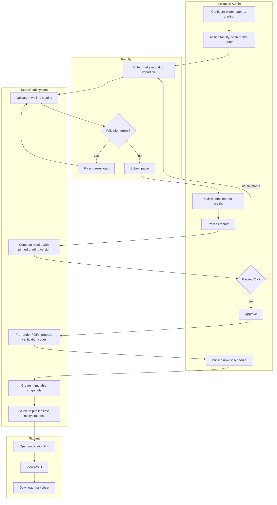
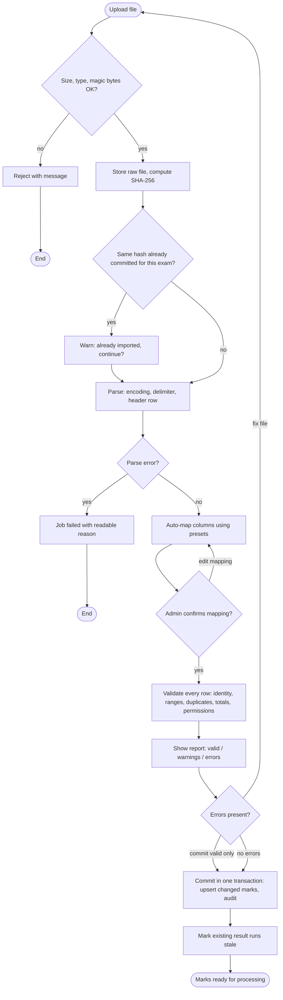
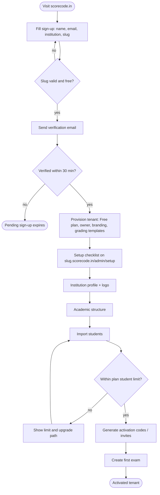
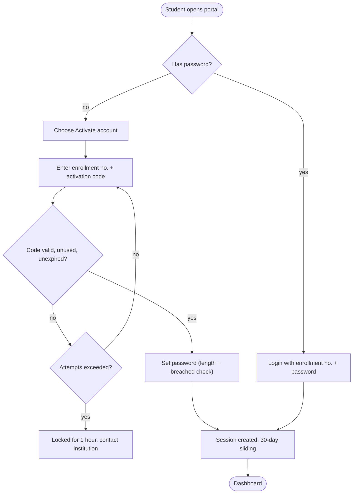
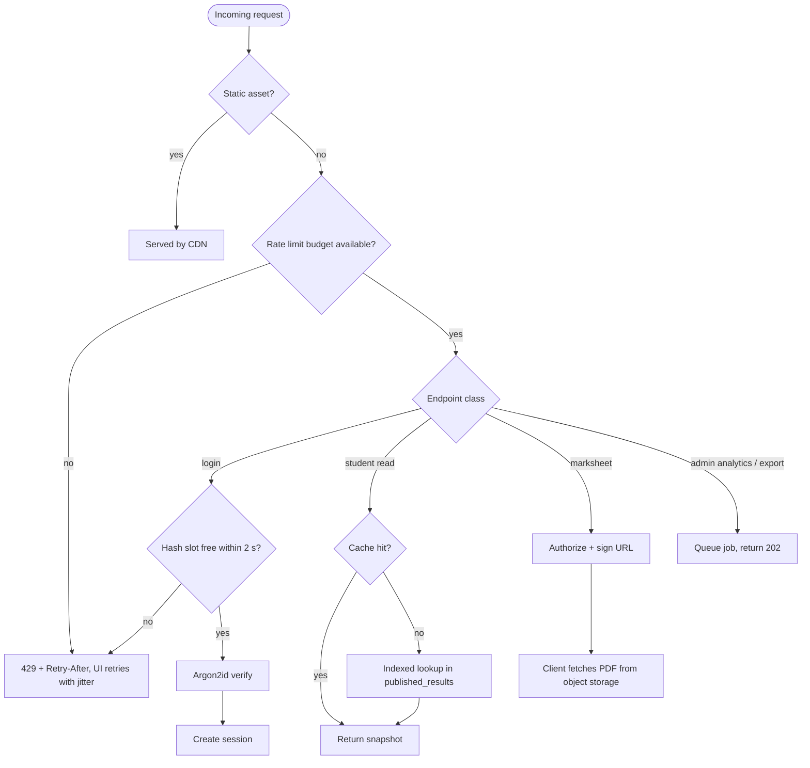

# Activity / Flow Diagrams

> Prose versions: [03 Core workflows](../03-core-workflows.md), [13 Result ingestion](../13-result-ingestion.md).

## 1. End-to-end result lifecycle (swimlanes)

## 2. Marks import pipeline

## 3. Institution onboarding

## 4. Student first login (activation)

## 5. Publication-day request handling under load

