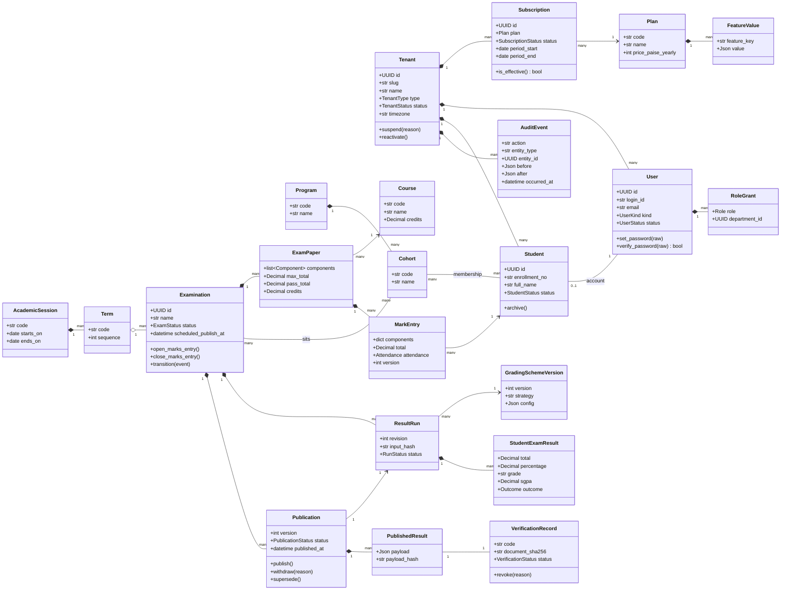
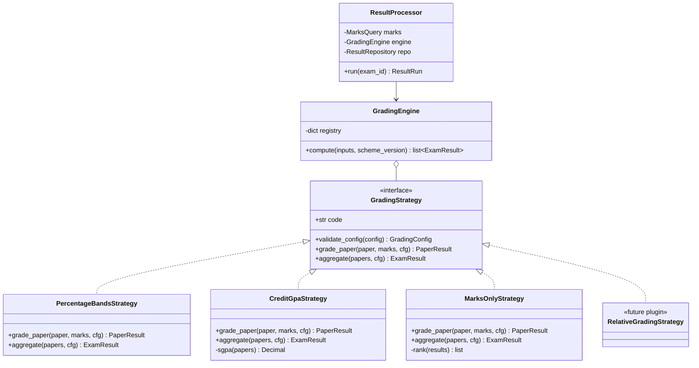
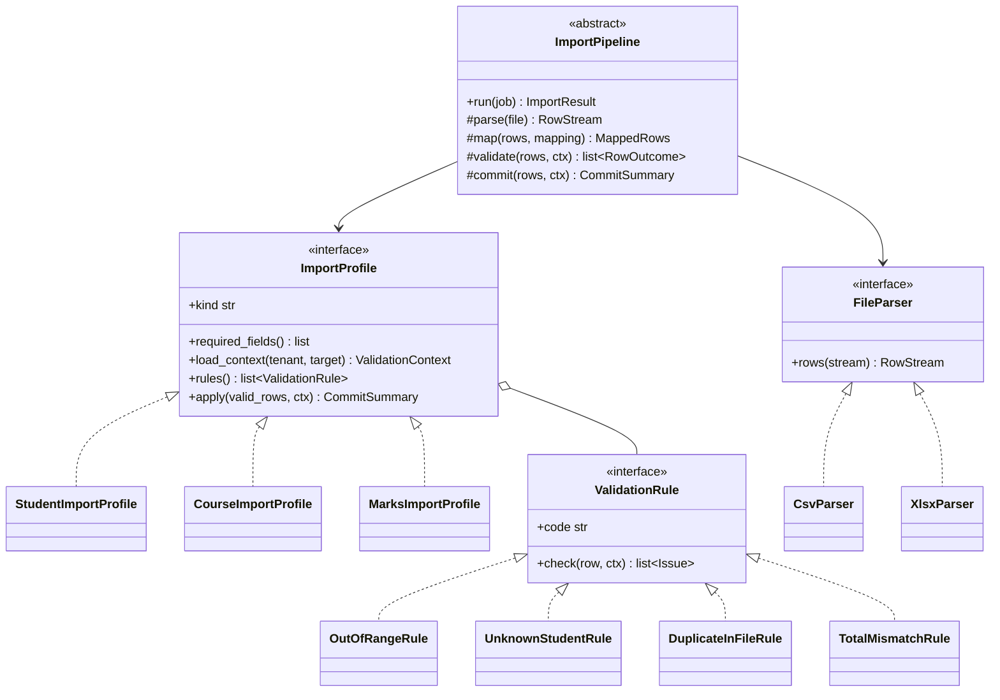
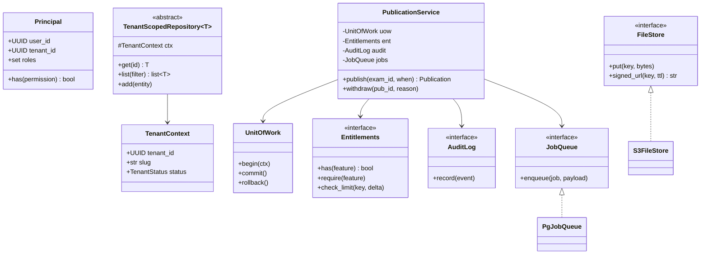

# Class Diagrams

> Domain model and key design patterns. Table-level detail is in [07 Database](../07-database-design.md); module structure in [08 Backend](../08-backend-architecture.md).

## 1. Core domain model (simplified)

## 2. Grading engine — Strategy pattern (open/closed principle)

## 3. Import pipeline — Template Method + profiles

## 4. Application layer — services, repositories, dependency inversion

