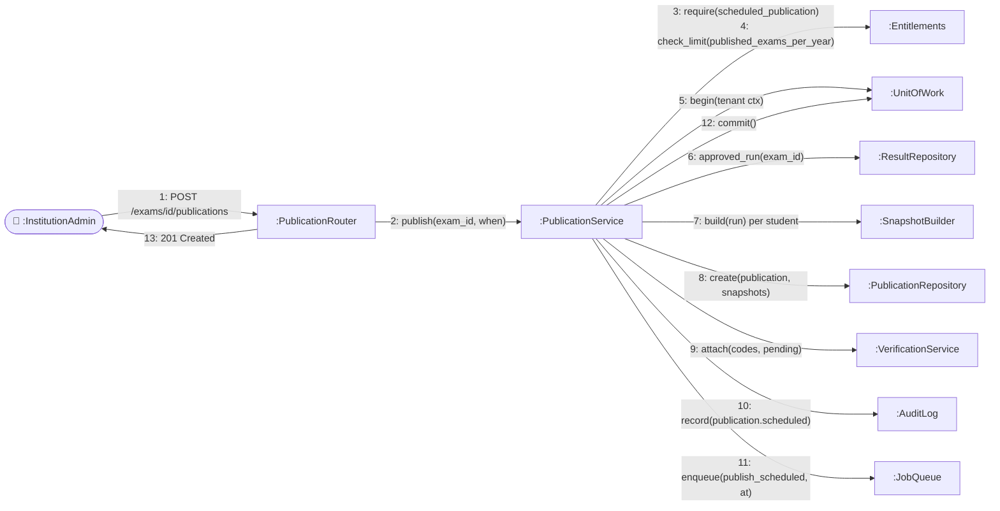
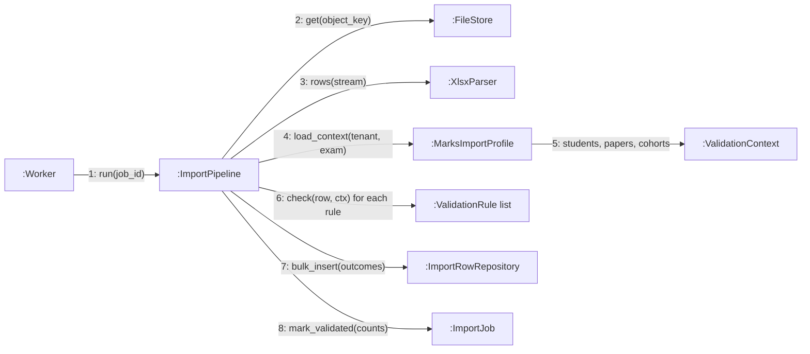
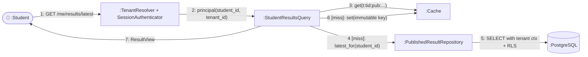
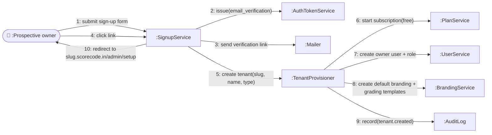

# Collaboration (Communication) Diagrams

> UML communication diagrams emphasise **which objects collaborate** and the **numbered order of messages** between them (the same information as a sequence diagram, organised around structure rather than time). Mermaid has no native communication diagram, so these use flowcharts with numbered message labels on links.

## 1. Publishing an exam's results

## 2. Validating an uploaded marks file (worker side)

## 3. Student reading a result (read path)

## 4. Tenant onboarding

