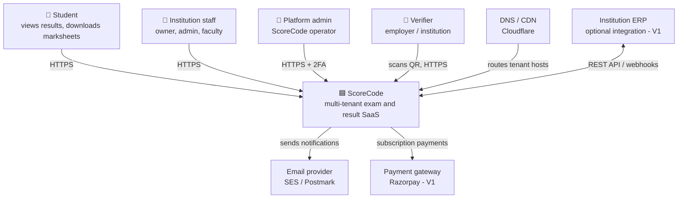
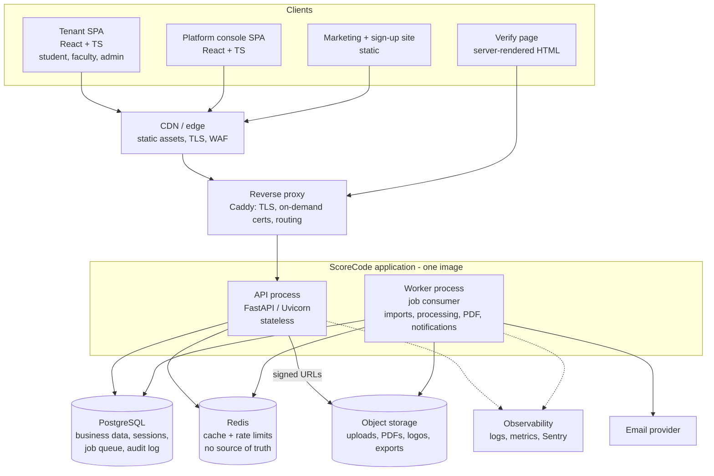
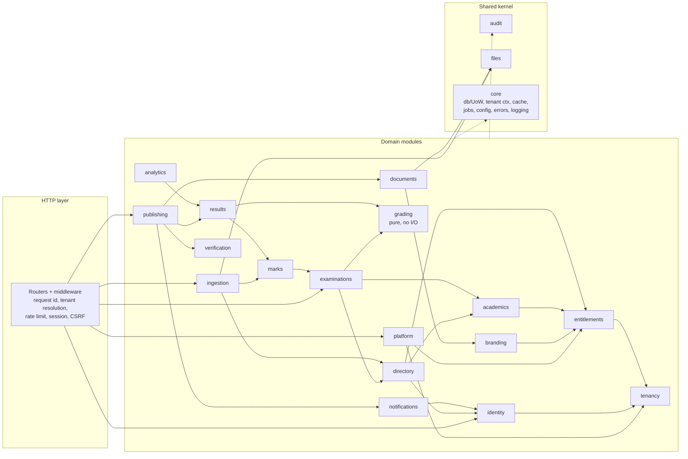
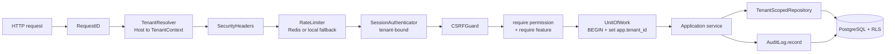

# Context, Container and Component Diagrams

> Explained in [05 System design](../05-system-design.md) and [08 Backend architecture](../08-backend-architecture.md).

## 1. System context (C4 level 1)

## 2. Containers (C4 level 2)

## 3. Backend component diagram (modules)

Arrows = "depends on (calls public API of)". Modules only use each other's `api.py` interfaces; enforced by import-linter.

## 4. Request pipeline components

