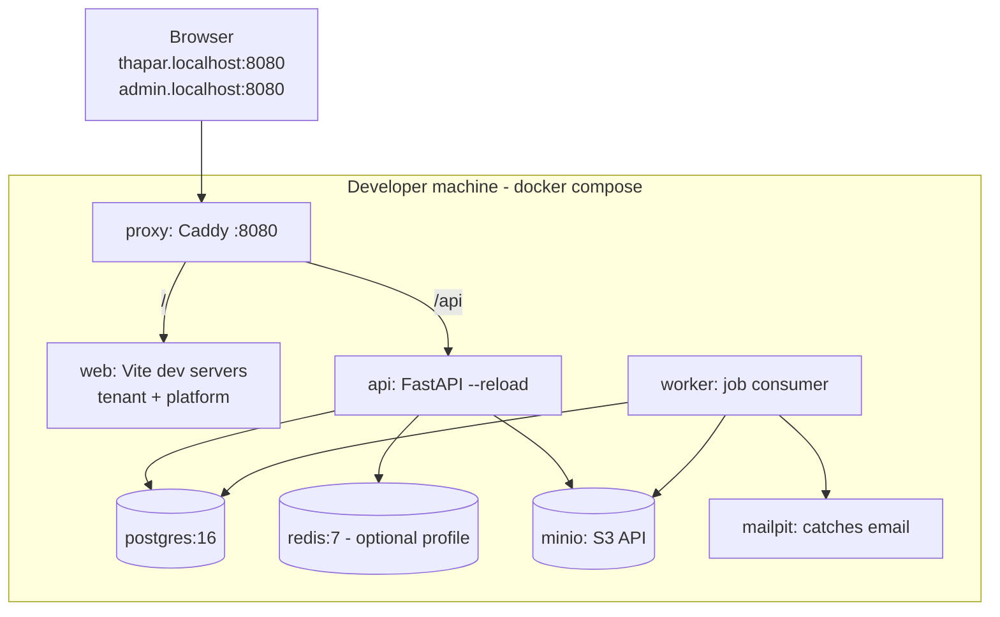
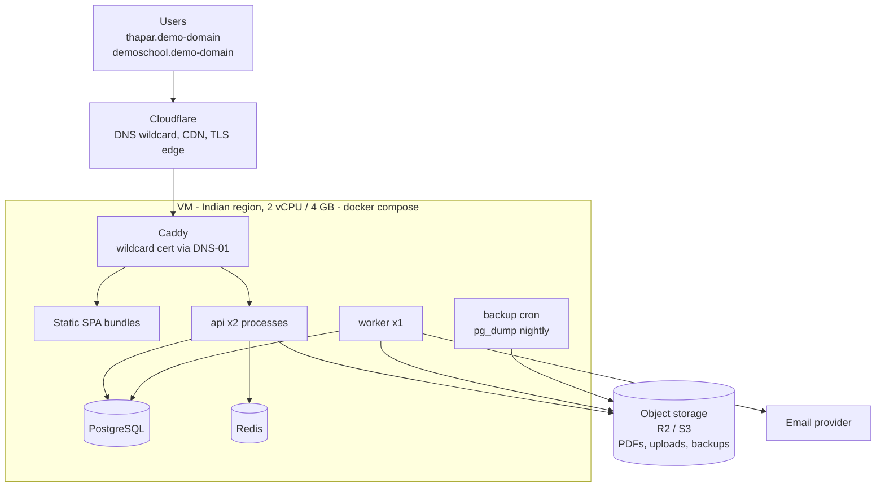
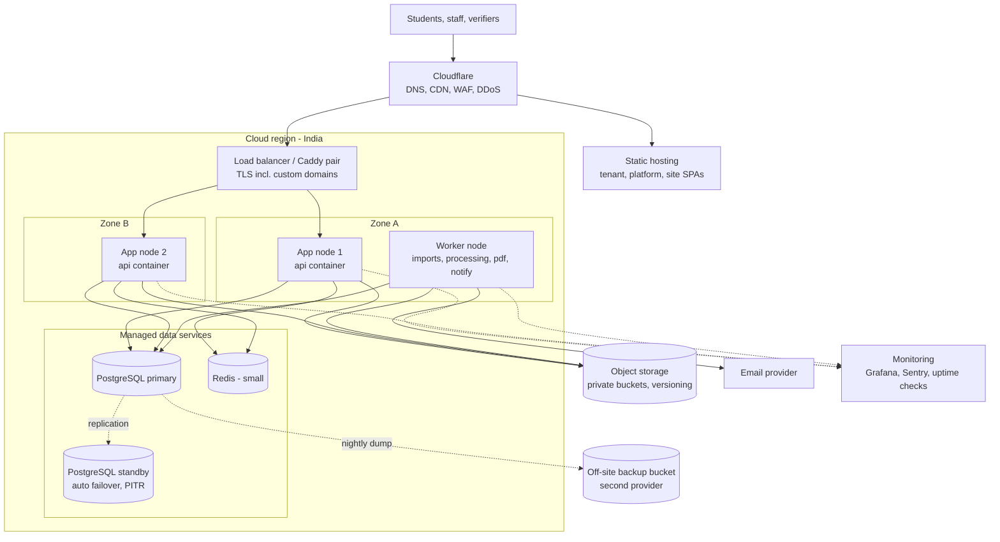
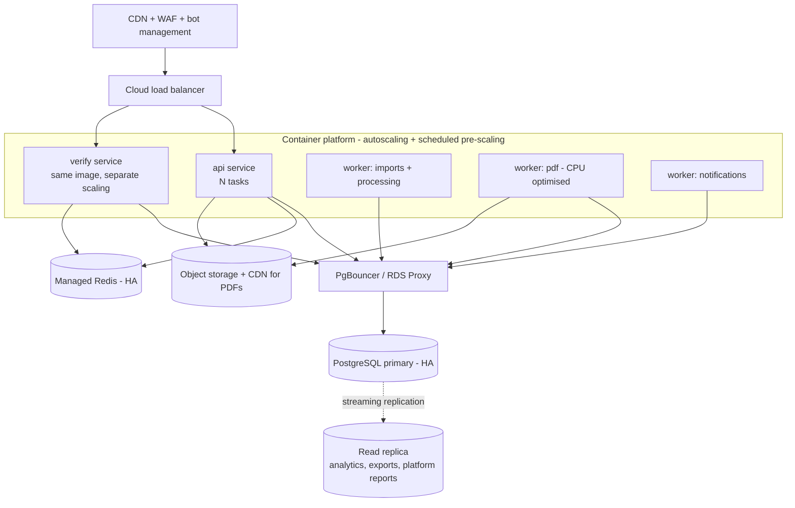
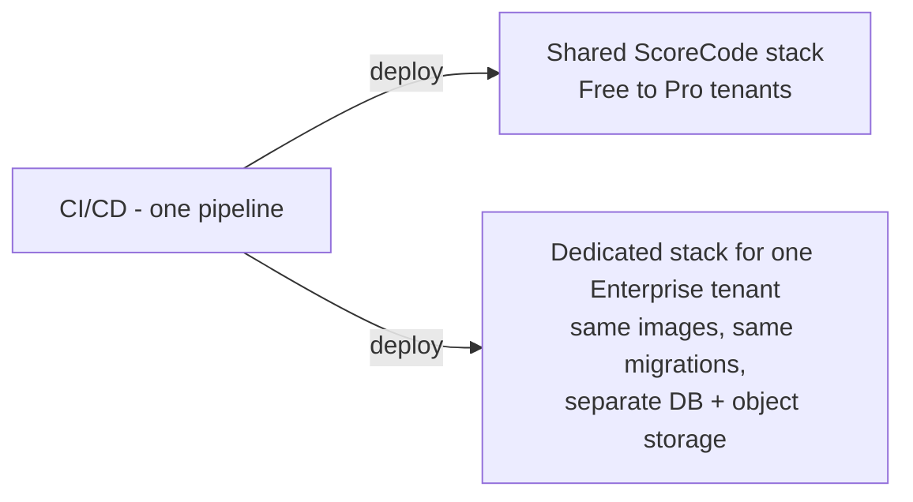

# Deployment Diagrams

> Explained in [14 Deployment & operations](../14-deployment-and-operations.md). Costs in [16 Cost model](../16-cost-model.md).

## 1. Development (docker compose on a laptop)

## 2. Demo (single VM)

## 3. Small production

## 4. Growing production

## 5. Enterprise silo (same code, dedicated stack)

