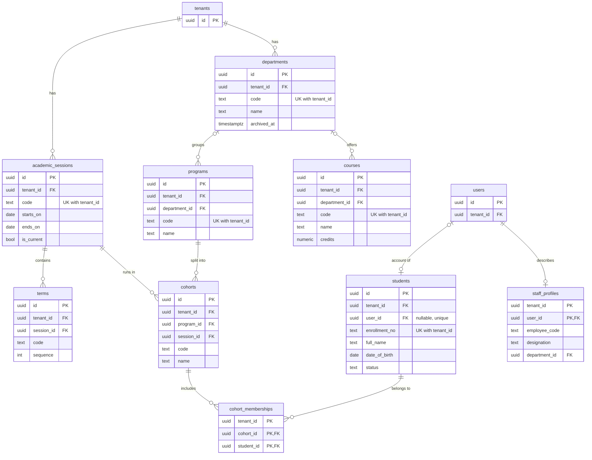
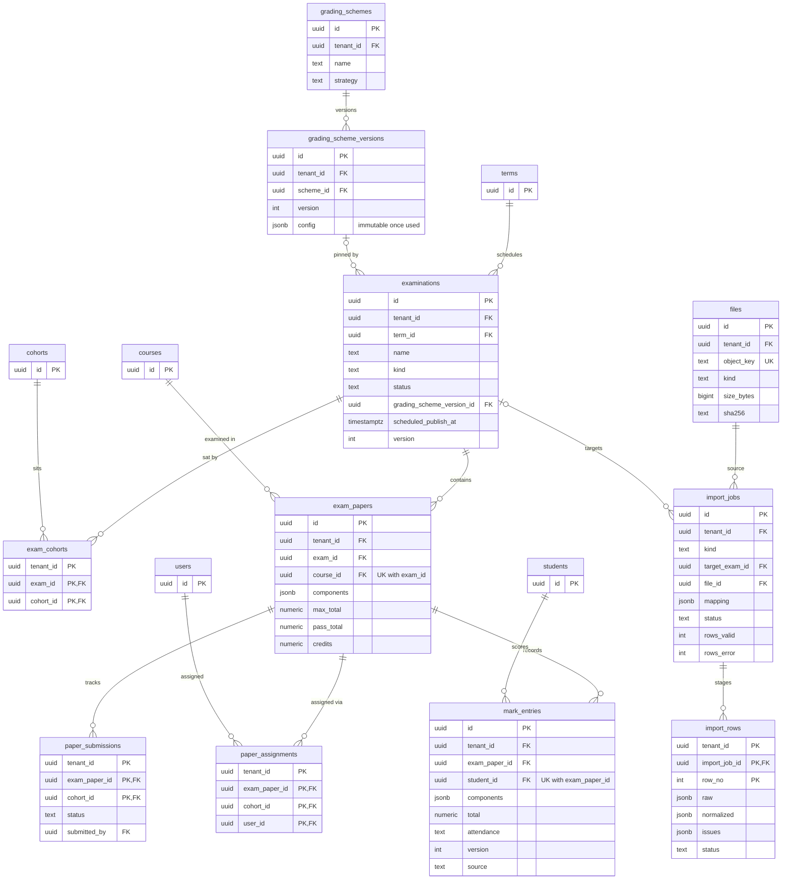
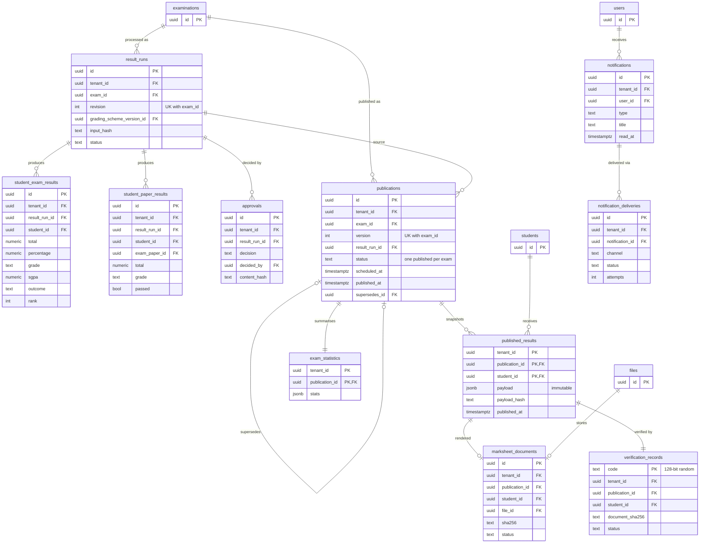

# Entity-Relationship Diagrams

> Data dictionary, constraints, indexes and deletion rules: [07 Database](../07-database-design.md).
> Convention reminder: every tenant-owned table carries `tenant_id` and references parents through **composite keys `(tenant_id, id)`**. For readability `tenant_id` is shown only where it matters; `created_at`/`updated_at` are omitted.

## 1. Platform, tenancy, identity and entitlements

```mermaid
erDiagram
    plans ||--o{ plan_features : defines
    features ||--o{ plan_features : "valued in"
    tenants ||--o{ tenant_subscriptions : has
    plans ||--o{ tenant_subscriptions : "subscribed as"
    tenants ||--o{ tenant_feature_overrides : has
    features ||--o{ tenant_feature_overrides : overrides
    tenants ||--o{ tenant_usage_counters : meters
    tenants ||--o{ tenant_domains : "served on"
    tenants ||--|| tenant_settings : configures
    tenants ||--|| tenant_branding : brands
    tenants ||--o{ users : employs
    users ||--o{ user_roles : granted
    users ||--o{ sessions : opens
    users ||--o{ auth_tokens : receives
    tenants ||--o{ audit_logs : records

    plans {
        uuid id PK
        text code UK
        text name
        bigint price_paise_yearly
        bool is_public
    }
    features {
        text key PK
        text kind "boolean, limit, enum_set"
        jsonb default_value
    }
    plan_features {
        uuid plan_id PK, FK
        text feature_key PK, FK
        jsonb value "null means unlimited"
    }
    tenants {
        uuid id PK
        text slug UK
        text name
        text type
        text status
        text timezone
    }
    tenant_domains {
        text domain PK
        uuid tenant_id FK
        text status
        text verification_token
        timestamptz verified_at
    }
    tenant_subscriptions {
        uuid id PK
        uuid tenant_id FK
        uuid plan_id FK
        text status "one active per tenant"
        date period_start
        date period_end
    }
    tenant_feature_overrides {
        uuid tenant_id PK, FK
        text feature_key PK, FK
        jsonb value
        timestamptz expires_at
        text reason
    }
    tenant_usage_counters {
        uuid tenant_id PK, FK
        text metric PK
        bigint value
    }
    tenant_settings {
        uuid tenant_id PK, FK
        text approval_mode
        text student_activation_mode
        text verification_disclosure
    }
    tenant_branding {
        uuid tenant_id PK, FK
        text display_name
        uuid logo_file_id FK
        text primary_color
        text secondary_color
        text font_family
        bool show_powered_by
    }
    users {
        uuid id PK
        uuid tenant_id FK
        text login_id "UK with tenant_id"
        text email
        text password_hash
        text kind "staff or student"
        text status
    }
    user_roles {
        uuid tenant_id PK
        uuid user_id PK, FK
        text role PK
        uuid department_id FK
    }
    sessions {
        text id PK "sha256 of token"
        uuid tenant_id FK
        uuid user_id FK
        timestamptz expires_at
        timestamptz revoked_at
    }
    auth_tokens {
        text token_hash PK
        uuid tenant_id FK
        uuid user_id FK
        text purpose
        timestamptz expires_at
        timestamptz consumed_at
    }
    audit_logs {
        uuid id PK
        uuid tenant_id FK
        text actor_type
        uuid actor_id
        text action
        text entity_type
        uuid entity_id
        jsonb before
        jsonb after
        timestamptz occurred_at "partition key"
    }
```

## 2. Academic structure and directory

## 3. Examinations, marks, ingestion

## 4. Results, publication, documents, verification, notifications

