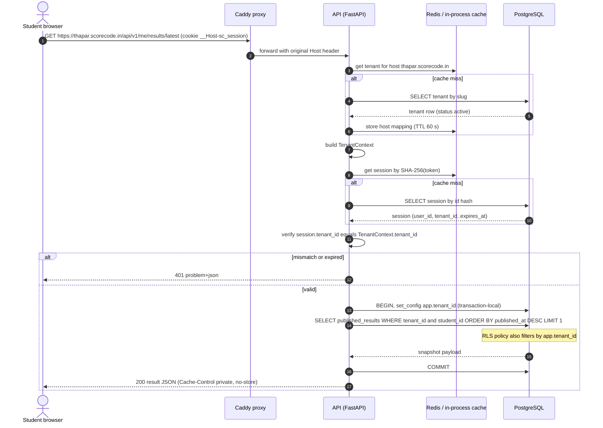
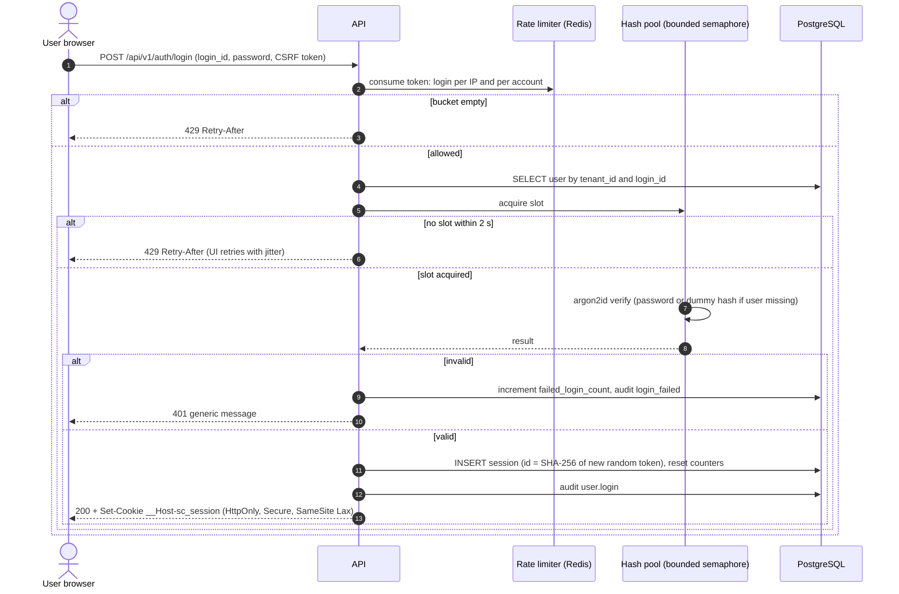
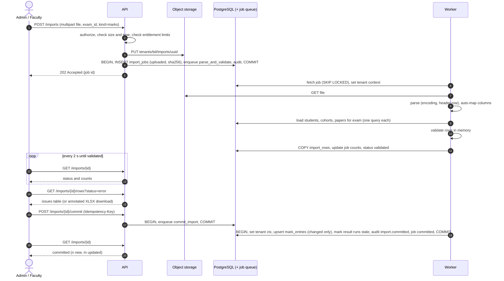
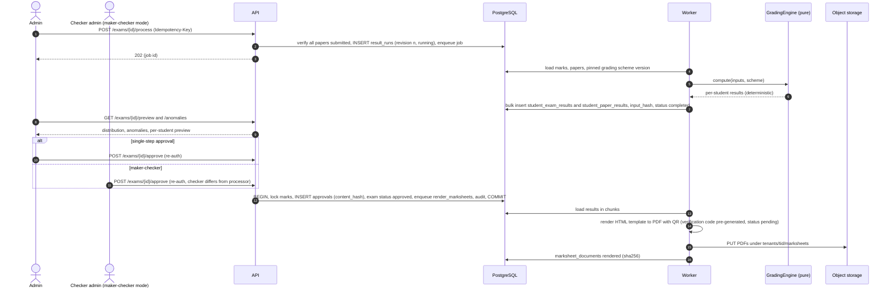
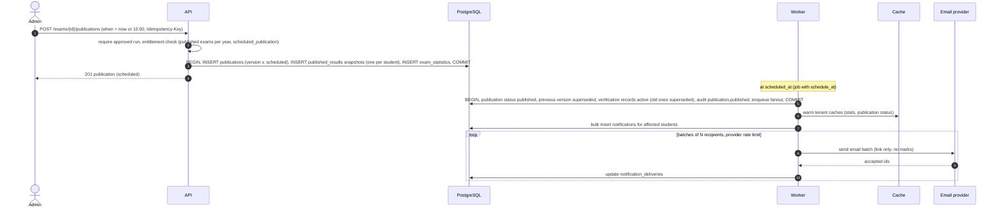
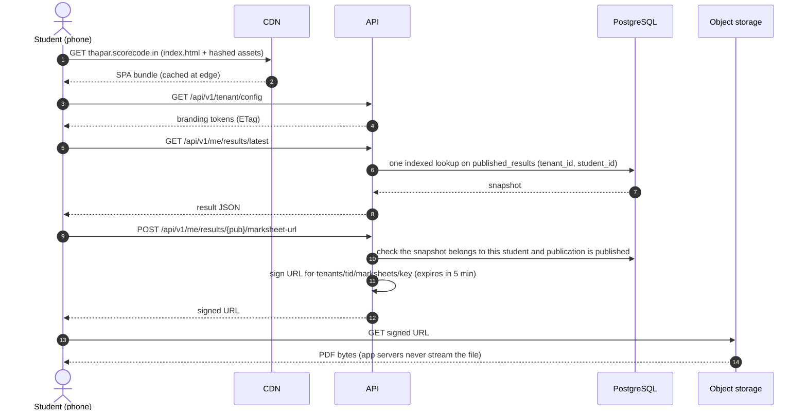
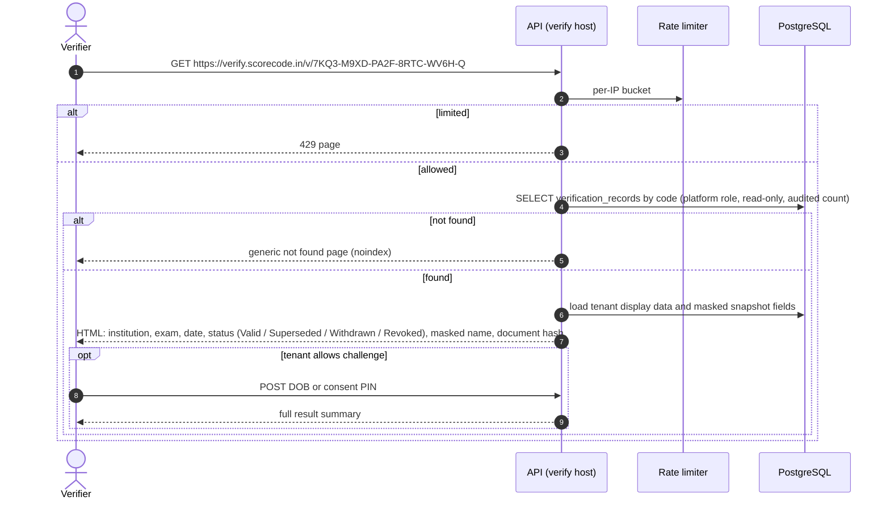
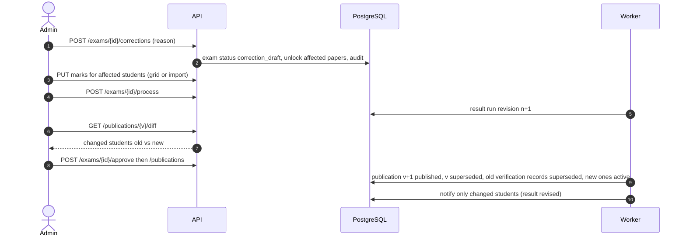

# Sequence Diagrams

> Key interactions. Workflows in prose: [03 Core workflows](../03-core-workflows.md).

## 1. Tenant resolution and authenticated request

## 2. Login with rate limiting and Argon2id

## 3. Marks import: upload, validate, commit

## 4. Result processing and approval

## 5. Publication (immediate or scheduled)

## 6. Student views result and downloads marksheet

## 7. Third-party verification

## 8. Correction and re-publication

