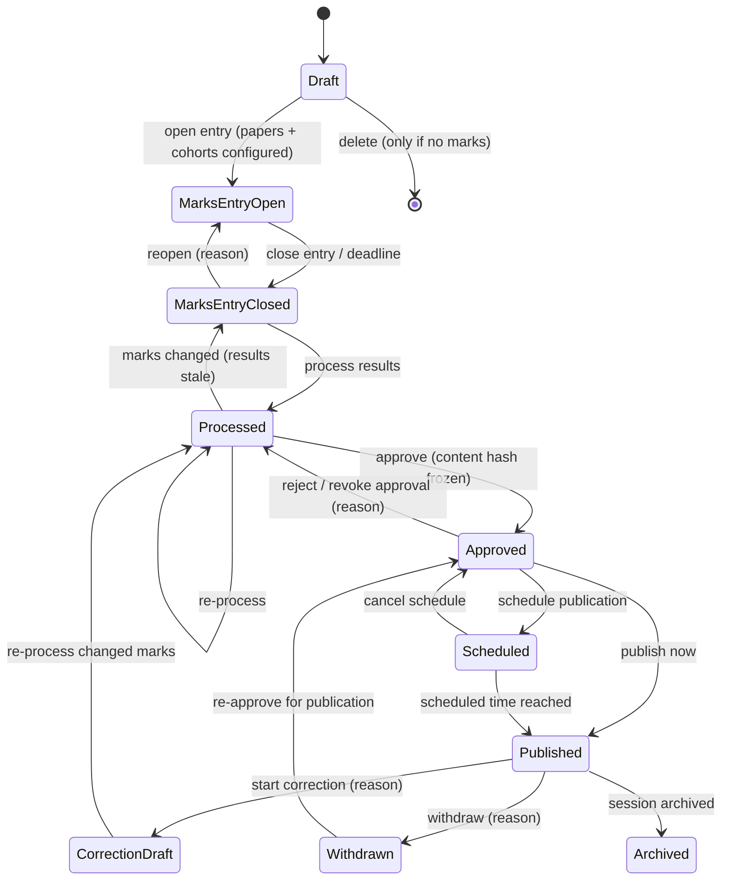
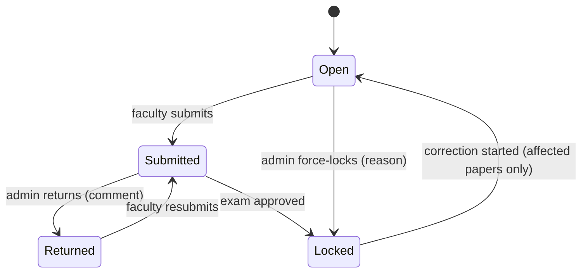
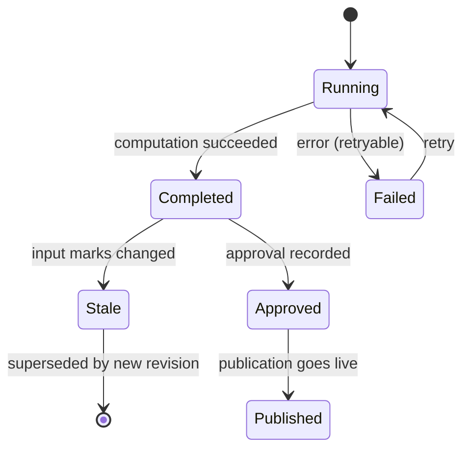
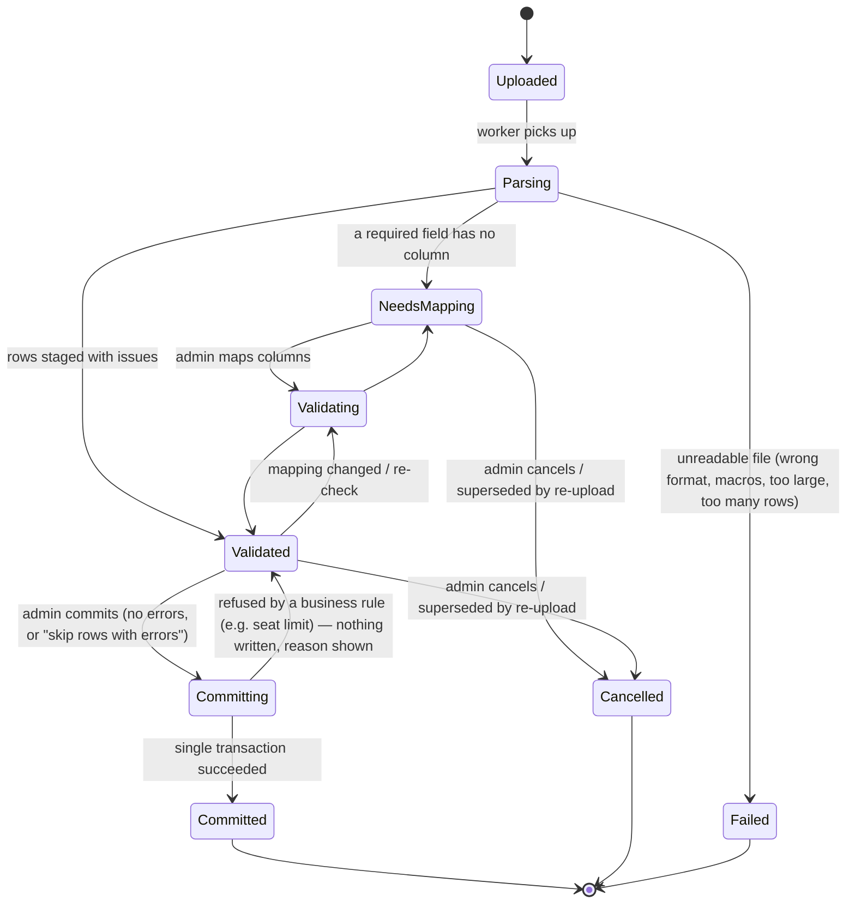
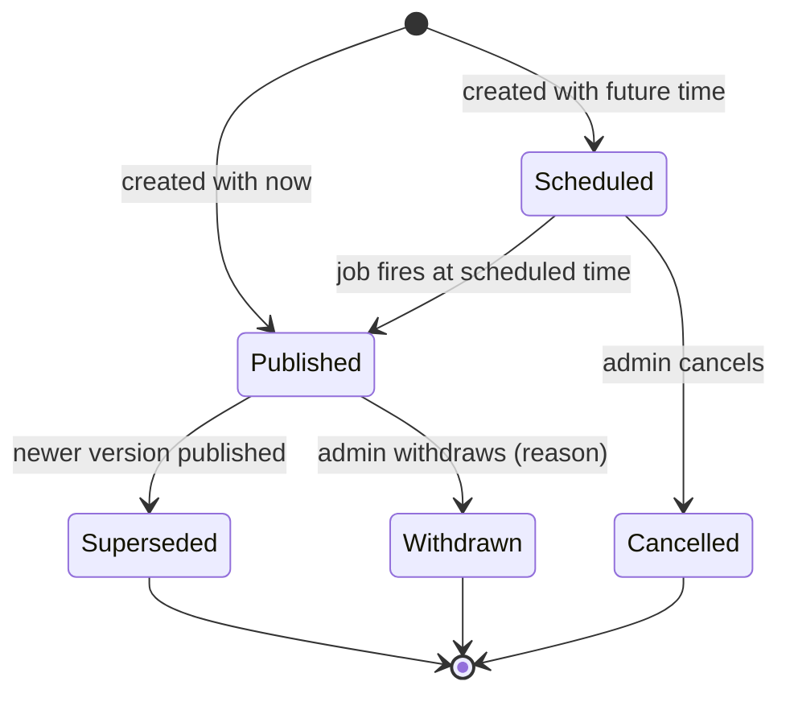
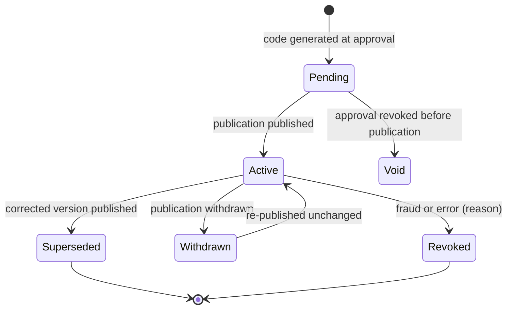
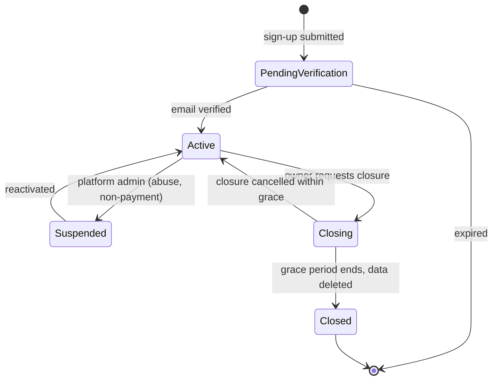
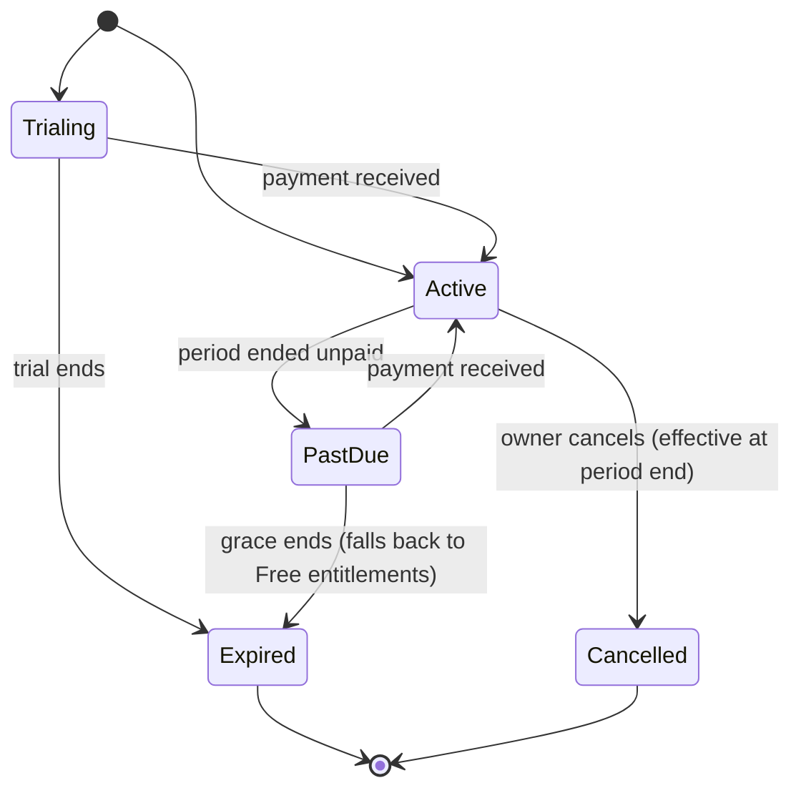

# State Machine Diagrams

> State machines are implemented as explicit transition tables in each module's `domain.py` and tested exhaustively (every legal transition allowed, every other rejected). Every transition writes an audit event.

## 1. Examination lifecycle

## 2. Paper submission (per paper x cohort)

## 3. Result run

## 4. Import job

## 5. Publication

## 6. Verification record

## 7. Tenant

## 8. Subscription

