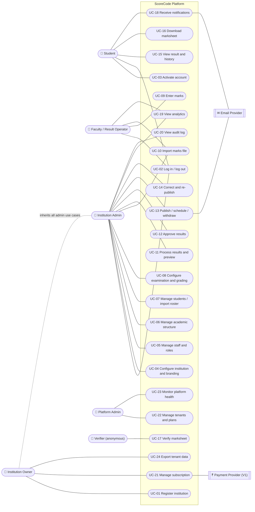
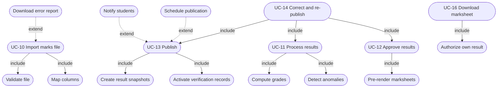
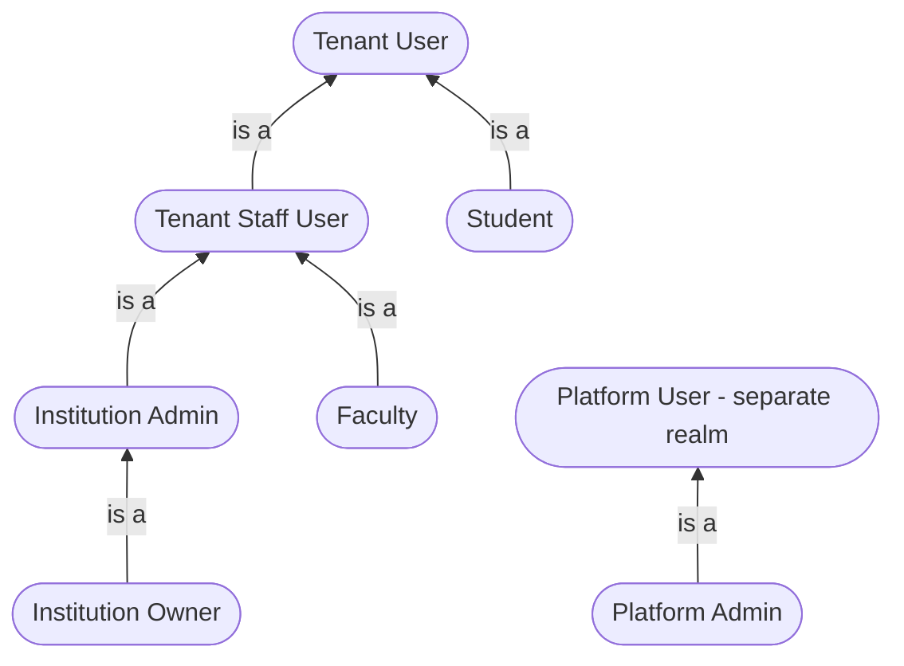

# Use-Case Diagram

> Textual use-case specifications (pre/post-conditions, main and alternate flows) are in the [SRS §3](../SRS.md#3-use-cases).

## 1. Overall system use cases

## 2. Include / extend relationships (result pipeline)

## 3. Actor generalisation

